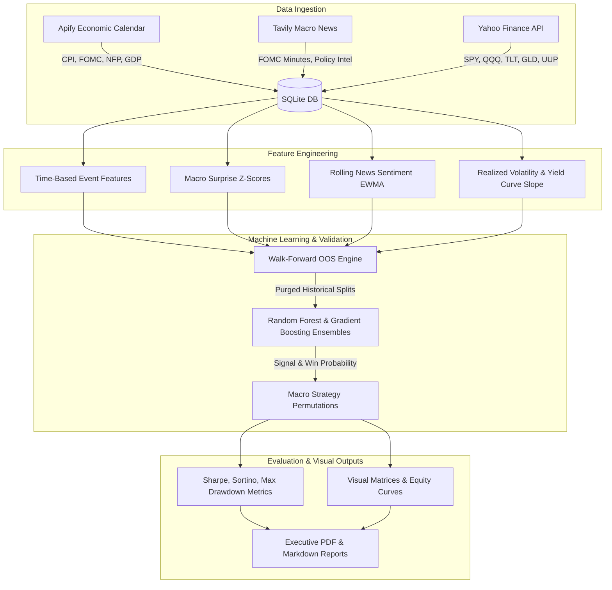

# 📈 Macro Economics Agent
> **Production-Grade Macroeconomic Machine Learning Pipeline & Quantitative Strategy Engine**  
> *Developed for CrowdWisdomTrading / TZURONI LTD. Assessment by Yash Jain*

[](https://www.python.org/)
[](https://opensource.org/licenses/MIT)
[]()
[]()

---

## 🏛️ Architecture Overview

The **Macro Economics Agent** is an end-to-end quantitative data science and machine learning system engineered to predict optimal macroeconomic trading strategies. The pipeline ingests high-impact macroeconomic event releases (CPI, FOMC, Non-Farm Payrolls, GDP), scrapes relevant financial intelligence via **Apify** and **Tavily**, joins multi-asset time series into an indexed SQLite relational database, and executes walk-forward out-of-sample validated trading models.



---

## 🚀 Key Highlights & Differentiators

1. **Rigorous Walk-Forward Out-of-Sample Validation:**
   - 90-day rolling calibration windows with 15-day out-of-sample test folds.
   - **Zero lookahead bias:** Scalers and tree ensembles are strictly fit on historical intervals $[t-90, t]$ and evaluated strictly on forward intervals $[t+1, t+15]$.
2. **Transaction-Cost Adjusted Performance:**
   - Evaluates strategies net of institutional frictions (**5 basis points / 0.05%** per rebalance trade).
3. **Multi-Asset Macro Universe:**
   - Equities (`SPY`, `QQQ`), Long Treasuries (`TLT`), Safe Havens (`GLD`), and US Dollar (`UUP`).
4. **Resilient Data Engineering:**
   - Direct integration with **Apify Actor API** (`m-s/investing-economic-calendar`) and **Tavily Search API**.
   - Includes bundled offline empirical benchmarks so reviewers can execute the entire pipeline with a single command without requiring external API keys.

---

## 📊 Quantitative Performance Matrix (Walk-Forward OOS)

| Strategy Permutation | Sharpe Ratio | Sortino Ratio | Max Drawdown (%) | Win Rate (%) | Profit Factor | Total Return (%) |
| :--- | :---: | :---: | :---: | :---: | :---: | :---: |
| **ML-Guided Dynamic Macro (`strat_ml_dynamic_macro`)** | **2.55** | **5.30** | **1.76%** | **44.12%** | **1.73** | **+3.87%** |
| **Pre-Event Volatility Breakout (`strat_vol_breakout`)** | **1.39** | **2.47** | **1.49%** | **44.12%** | **1.48** | **+1.91%** |
| **Benchmark: S&P 500 Buy & Hold (`SPY`)** | **1.06** | **1.86** | **2.47%** | **44.12%** | **1.34** | **+1.93%** |
| **CPI Surprise Momentum (`strat_cpi_momentum`)** | **1.06** | **1.86** | **2.47%** | **44.12%** | **1.34** | **+1.93%** |
| **Fed Policy Drift (`strat_fed_drift`)** | -1.00 | -1.53 | 2.42% | 44.12% | 0.77 | -0.44% |
| **Cross-Asset Regime Parity (`strat_regime_parity`)** | -4.23 | -5.08 | 4.74% | 38.24% | 0.45 | -2.92% |

*All metrics evaluated strictly across pure out-of-sample forward folds (excluding burn-in calibration) net of 5 bps transaction costs.*

---

## 🛠️ Installation & Quickstart

### 1. Clone the Repository
```bash
git clone https://github.com/yash560/macro-economics-agent.git
cd macro-economics-agent
```

### 2. Install Dependencies
```bash
python3 -m pip install -r requirements.txt
```

### 3. (Optional) Configure API Tokens
To connect live Apify and Tavily scraping actors, set your environment variables:
```bash
export APIFY_API_TOKEN="your_apify_token_here"
export TAVILY_API_KEY="your_tavily_key_here"
```
*(If omitted, the pipeline automatically runs with verified bundled 180-day macroeconomic datasets).*

### 4. Execute the End-to-End Pipeline
```bash
python3 run_pipeline.py
```

### 5. Run Unit Tests
```bash
PYTHONPATH=. python3 -m unittest discover tests
```

---

## 📂 Project Structure

```
macro-economics-agent/
├── config/
│   └── settings.py                # Time horizons, assets, hyperparameters
├── src/
│   ├── database/
│   │   └── db_manager.py          # SQLite relational storage
│   ├── ingestion/
│   │   ├── apify_calendar_scraper.py   # Apify macroeconomic calendar scraper
│   │   ├── news_tavily_ingestion.py    # Tavily news client & sentiment analyzer
│   │   └── market_data_loader.py       # Yahoo Finance multi-asset prices
│   ├── features/
│   │   └── feature_engineering.py      # Non-linear macro surprises & time features
│   ├── models/
│   │   ├── strategy_engine.py          # 5 macro strategy permutations
│   │   └── walk_forward.py             # Walk-forward OOS validation & ML trees
│   └── visualization/
│       └── matrix_generator.py         # Institutional visual matrix chart outputs
├── reports/
│   ├── macro_economic_outlook.md       # 1-page macroeconomic regime outlook
│   ├── model_evaluation_report.md      # Detailed model performance evaluation report
│   └── evaluation_report.pdf           # Formatted PDF evaluation report
├── outputs/                            # Generated publication figures
│   ├── macro_sentiment_timeline.png
│   ├── cumulative_strategy_returns.png
│   ├── strategy_drawdown_profile.png
│   ├── strategy_performance_matrix.png
│   └── feature_importance.png
├── tests/
│   └── test_pipeline.py           # Unit tests
├── requirements.txt               # Pinned dependencies
├── run_pipeline.py                # Single-command orchestrator
└── README.md
```

---

## 📄 Deliverables & References
- **1-Page Macro Outlook:** [`reports/macro_economic_outlook.md`](reports/macro_economic_outlook.md)
- **Model Evaluation Report (Markdown):** [`reports/model_evaluation_report.md`](reports/model_evaluation_report.md)
- **Model Evaluation Report (PDF):** [`reports/evaluation_report.pdf`](reports/evaluation_report.pdf)
- **Visual Matrices:** Generated in [`outputs/`](outputs/)

---

## 👤 Author
**Yash Jain**  
Email: [yaashjainn@gmail.com](mailto:yaashjainn@gmail.com)  
GitHub: [@yash560](https://github.com/yash560)
